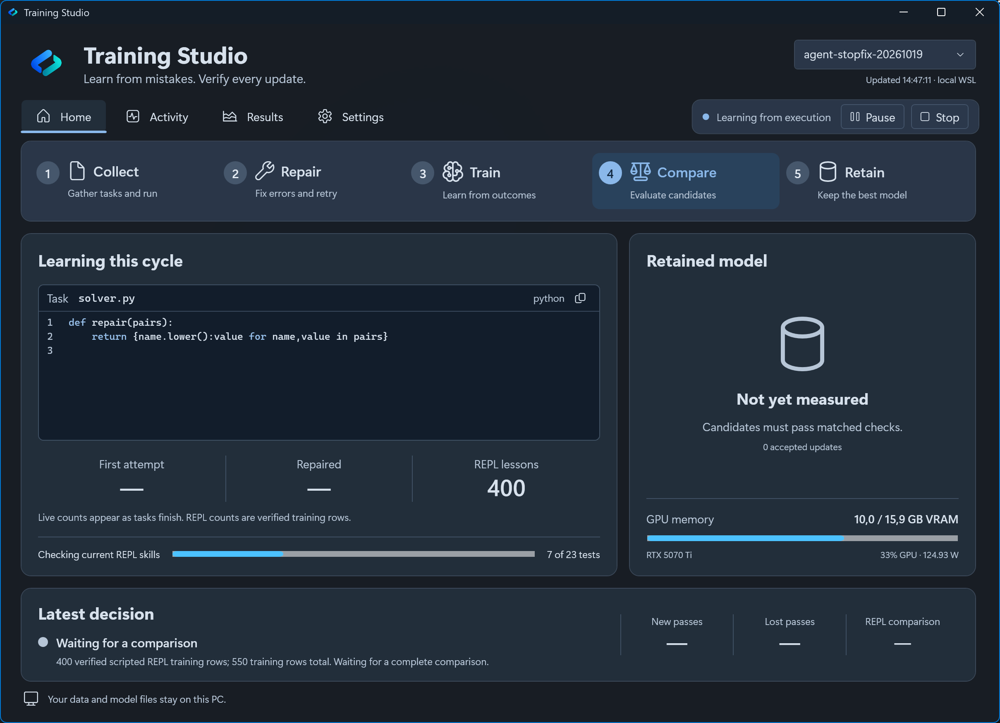

#  Training Studio

[](https://ko-fi.com/m1chl)
<a href="https://buymeacoffee.com/xdujifyzvt"></a>

A Windows desktop app for local AI fine-tuning on NVIDIA GPUs. Control WSL training, pause it for gaming, and compare coding results before accepting an update.

**Research prototype for 16 GB NVIDIA GPUs.** It needs a prepared WSL backend. More training does not guarantee better code.

[Download Training Studio](https://github.com/M1chlCZ/local-coding-assistant/releases/tag/studio-v0.1.3) · [Installation guide](desktop/README.md) · [Learning method](research/verified-learning.md)



*Windows 11 interface captured from the running 0.1.4-preview.5 app in Dark mode during the recovery baseline. A tinted Mica background, translucent slate panels and deeper code surfaces reduce bright areas. This earlier screenshot is retained because the post-comparison Windows capture returned blank frames. The full loop remains paused while later finite experiments are evaluated.*

## Windows training app

Training Studio controls local CUDA fine-tuning through WSL. It shows live activity, GPU use, saved checkpoints, and coding results.
Version **0.1.3** adds a simpler interface and a continuous training loop.
The loop uses Qwen3.5-4B with Python, Go, TypeScript, Rust, and Dart examples.
It requires a prepared WSL backend. Model files and private data stay on your PC.

- **Start / Stop** controls the session. **Pause** saves progress and releases the GPU for gaming.
- **Home** shows whether the model improves. **Activity** shows progress and errors.
- **Results** shows past comparisons. **Settings** contains startup preferences, GPU power, and appearance.
- The interface uses the Windows theme by default, with a subtle Mica background.

The loop collects answers that pass code tests, trains a small adapter, and compares its results with the retained model.
Rejected updates do not replace the retained model or end the loop. More training does not guarantee better code.

The **0.1.4 source preview** adds [execution learning](research/execution-learning.md): successful correction conversations, executed REPL repair lessons, a capped multilingual training mix, and matched recursive-agent checks before accepting an update. Its Windows 11 dashboard shows the current task, repair counts and rejection reasons, with Mica and translucent panels. Existing experiments and checkpoints stay separate. Both predeclared parent/child training settings completed with **0/8 repairs and 0/4 recursive repairs**, matching the base model. Neither qualified; the full learning loop remains paused. See the [measured pilot results](reports/agent-curriculum-pilot-20261019.json).

A separate corrective-imitation experiment completed with **0/10 → 2/10 repairs**, including **0/5 → 2/5 ordinary REPL repairs**, but **0/5 → 0/5 recursive repairs**. Independent regrading confirmed the two gains. The recursive requirement failed, so no adapter was promoted and the full loop remains paused. Held-out confirmation and the full general-code audit were not run. See the [verified recovery result](reports/agent-recovery-pilot-20261019.json) and [failure diagnosis](research/execution-learning.md#completed-corrective-imitation-comparison).

The subsequent [child-tested experiment](research/execution-learning.md#execution-tested-recursive-distillation) improved development repairs **2/10 → 6/10** and genuine recursive repairs **0/5 → 3/5** under matched instructions; ordinary REPL repairs stayed **2/5**. All returned patches were independently regraded. However, the selected candidate scored **0/5 → 0/5** on the five untouched confirmation repairs, so it was rejected. No full audit or restart followed the failed confirmation gate. See the [complete measured outcome](reports/agent-tested-development-20261019.json).

The [multi-file trial](reports/agent-multifile-trial-20261019.json) completed and was rejected: development repairs fell **1/15 → 0/15**, ordinary REPL repairs stayed **0/8**, and genuine recursive repairs stayed **0/7**. Its lessons used specification-derived checks without supplied test files, but the candidate returned no final patches. Independent verification regraded both baseline patches and confirmed the regression. The eight fresh confirmation tasks remain unused; the general-code audit and full-loop restart were not run.

A new [short-action recovery trial](research/execution-learning.md#short-repl-actions-and-recovery-imitation) tests validated REPL edits, automatic patch serialization and training on recovery from actual errors. Both models receive the same interface. The [finite comparison is running](reports/agent-actions-trial-20261020.json). No learning gain is established yet; fresh confirmation and the full retention audit remain required before restarting from Collect.

The Qwen evaluation server also has optional [schema-constrained JSON output](research/structured-output.md), using XGrammar. Text requests keep their existing behavior. Its separate same-weight format comparison is queued behind the frozen learning experiment; it cannot establish REPL or recursive learning gains.

[Download 0.1.3](https://github.com/M1chlCZ/local-coding-assistant/releases/tag/studio-v0.1.3) · [Release notes](releases/0.1.3.md) · [Installation guide](desktop/README.md) · [Learning method](research/verified-learning.md)

## Coding chat and agent launcher

A Windows launcher for English coding chat and agent use on a 16 GB NVIDIA GPU.
It runs llama.cpp on the PC through CUDA, with CPU offloading for larger models.
The system prompt requests English. The weights remain multilingual.

**Research prototype.** The default is Qwen3.8-27B with pinned Unsloth UD-Q4_K_M weights.
Setup downloads the model and runtime from their upstream repositories.
Our pruned Qwen3.6 derivative remains available through the [experiment recipe](research/recipe.md).
Its weights are not published yet.

## Run on Windows

Requirements: Windows x64, Python 3.10+, a recent NVIDIA driver, approximately 32 GB RAM, and 20 GB free disk.

Before setup, stop the model server.
Run these commands:

```powershell
py -3 launcher.py setup
py -3 launcher.py serve --open
```

Alternatively, double-click `start.cmd`.
Setup verifies download hashes. Ctrl+C stops the server.
The default uses an 8K context and eight CPU FFN layers.

If memory runs out, decrease `--context`.
For dense models, increase `--cpu-ffn`.
For MoE models, increase `--cpu-moe`.

If the pruned derivative exists on your PC, run the faster preset:

```powershell
py -3 launcher.py --manifest research/manifest-reap50.json serve --open
```

## Connect an agent

On the PC, open chat at `http://127.0.0.1:8080`.
For Mac access, use the [SSH connection instructions](research/wsl.md#connect-from-the-mac).

| API setting | Value |
| --- | --- |
| Base URL | `http://127.0.0.1:8080/v1` |
| Model | `local-coding-assistant` |
| API key, if the client requires one | `local` |

The external agent harness supplies tools and file access.
The API listens on loopback.

## Earlier focused training experiment

The [Qwen3.5-4B experiment](research/focused-training.md) trains on 2,456 complete Go and TypeScript repairs.
It compares the unchanged model, the trained adapter, and the previous student on matched coding tests.
Windows Pause and Resume preserve progress. Automatic recovery respects Pause, Stop, and completed experiments.
The experiment keeps the accepted model until the results receive review.

## Recursive coding experiment

The [RLM experiment](research/rlm.md) adds a bounded Python REPL and optional model subcalls.
A finite search compares instructions and recursion depth on separate development and holdout tasks.
The [adapter recipe](research/adapter-training.md) runs local QLoRA from successful training traces.
The [confirmation comparison](research/confirmation.md) checked both retained 4B adapters on ten reserved public repairs.
Both passed 9/10, against 1/10 for the unchanged base. The later training updates did not increase this confirmation score.
The [WSL recipe](research/wsl.md) runs the complete experiment on the PC through CUDA.
After WSL setup, `start-rlm.cmd` starts its model server.
The [learning session](research/learning-session.md) collects checked repairs and trains local adapters.
Double-click `learning.cmd` for Windows Start, Pause, Resume, and Stop controls.
Checkpoints retain the optimizer and current step.
[Continuous mode](research/continuous-learning.md) prepares fresh checked public tasks and runs until Pause or Stop.
The [multilingual curriculum](research/polyglot.md) rotates Python, Go, TypeScript, Rust, and Dart with mixed replay and separate language scores.
The latest full audit scored 473/790 for the base model and 433/790 for the RLM adapter.
The revised [balanced code trial](research/polyglot.md#balanced-code-trial) preserves verified language examples and compares fresh training with continued adapter training.
It trains verified source answers instead of REPL actions. No quality improvement is established for this new recipe yet.
The optional [student correction trial](research/polyglot.md#student-correction-trial) compares teacher answers with checked corrections to student mistakes.
Direct checks can batch up to sixteen independent prompts on one CUDA model and run two compiler checks in parallel.
Long prompts split into smaller GPU batches under a 32,768-token budget, including padding and output.
Changing the batch size starts a fresh matched development baseline. An audit already in progress keeps its original settings.
It recovers after Windows login when previously running. Pause releases the GPU for gaming and remains saved across logins.
The earlier tuned session uses 30 repair tasks, visible tests, and short training candidates.
Candidates receive 15 development checks before acceptance. Three rounds without improvement stop the session.
The [training evidence](research/rlm-training-evidence.md) compares published RLM methods, available weights, and history-derived data.
The [public-data pilot](research/public-data.md) prepares checked Python repairs from NVIDIA OpenCodeInstruct.
Its initial 4B candidate passed 7/10 development tasks, against 5/10 for the previous adapter, and preserved its older passes.
The [Strata pilot](research/strata.md) measures a larger MoE teacher on the same GPU.
The [private history tool](research/private-history.md) exports local Codex messages and requests task ideas from the PC's model.
Exports, reviews, and private adapters stay in the ignored `private-data/` directory.
History-derived ideas need executable tests before training.

## Earlier measured results

The [benchmark guide](research/benchmarking.md) separates training checks, reserved repair tests, and direct coding benchmarks.
Training uses a separate Qwen3-4B student.
On all 164 HumanEval tasks, its unchanged NF4 base passed 118 and the accepted adapter passed 121.
The adapter gained 14 tasks and lost 11, so the higher total does not establish an improvement without regressions.
The earlier continuous mode uses a six-active-hour limit and schedules repair checks and a full HumanEval audit after each experiment.
The Studio loop in 0.1.3 has no time limit and uses the comparison schedule in the learning method.
Unchanged accepted weights reuse verified results. The Windows controls show the schedule and last complete comparison.

RTX 5070 Ti, Ryzen 9 9900X, 32 GB RAM, 8K context:

| Model | Coding subset | Practical pilot | Median decode speed |
| --- | ---: | ---: | ---: |
| Qwen3.8-27B, eight CPU FFN layers | 32/32 | 5/5 | 25 tokens/s |
| Our pruned Qwen3.6, no CPU expert offload | 29/32 | 5/5 | 183 tokens/s |
| MiMo V2.6 Distill 9B, no thinking | 20/32 | 4/5 | 117 tokens/s |

These small samples do not establish broad agent reliability.
Different quantization methods prevent an isolated comparison of model architectures.
The [comparison notes](research/candidates.md) record recent releases, memory use, and failures.
On 15 authored REPL repairs, the previous 4B adapter passed 8/15 against its base at 0/15.
The [tuning notes](research/learning-session.md#expanded-baseline-result) separate those baseline results from the revised training run.
The [model card](MODEL_CARD.md) describes our derivative and its limits.

## Reproduce

```powershell
py -3 test_launcher.py
py -3 test_evaluation.py
```

See the [recipe](research/recipe.md) for compression and evaluation commands.
Docker isolates generated code during evaluation.

Before publishing, run `python3 check_public_data.py --history`.
The check detects personal home paths, private history records, and SSH tunnel hosts outside the documented example.
To run it before each push, use `git config core.hooksPath .githooks`.
Review credentials and screenshots separately.

Original code uses the [MIT license](LICENSE).
Upstream model licenses remain separate.
See [NOTICE.md](NOTICE.md) and [ATTRIBUTION.md](ATTRIBUTION.md) for sources and redistribution terms.

If this project helps you, consider giving it a star. Bug reports and contributions are welcome.
